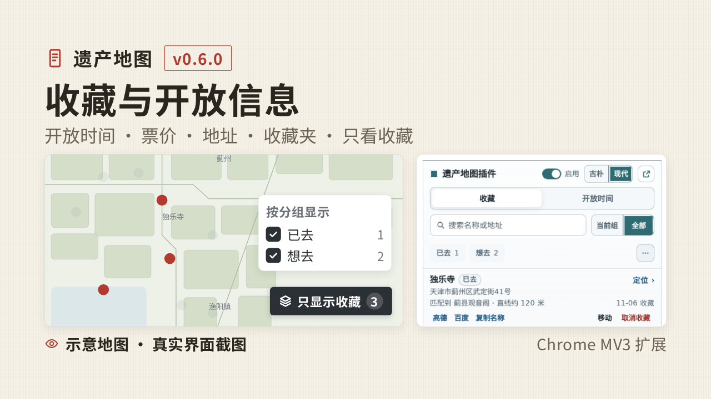
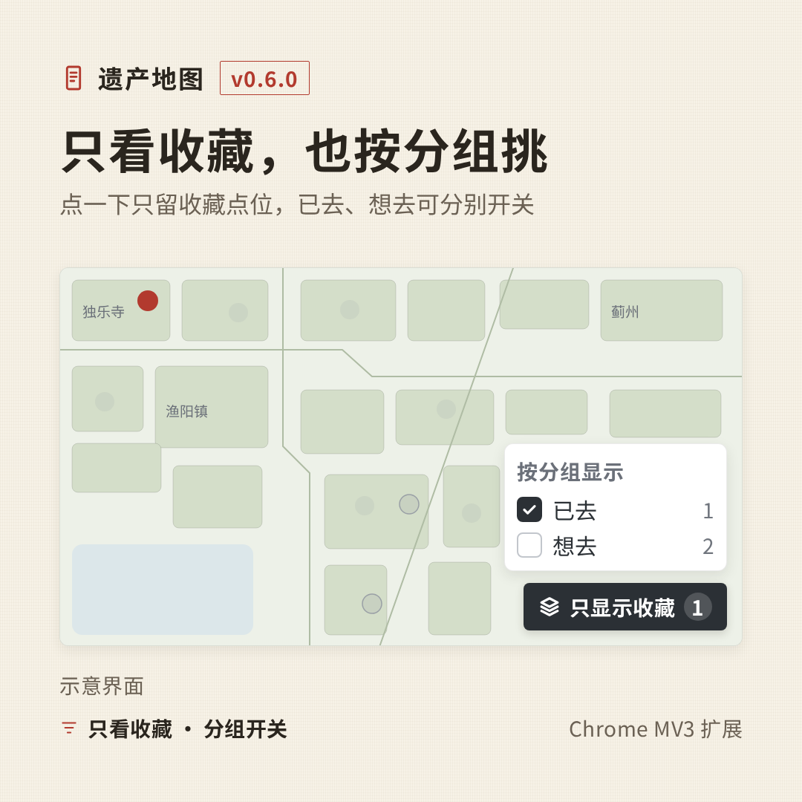
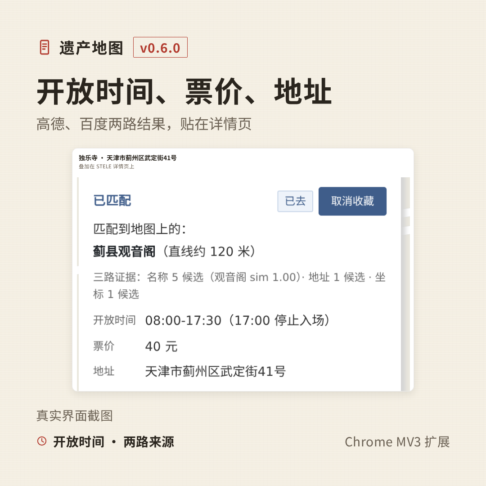
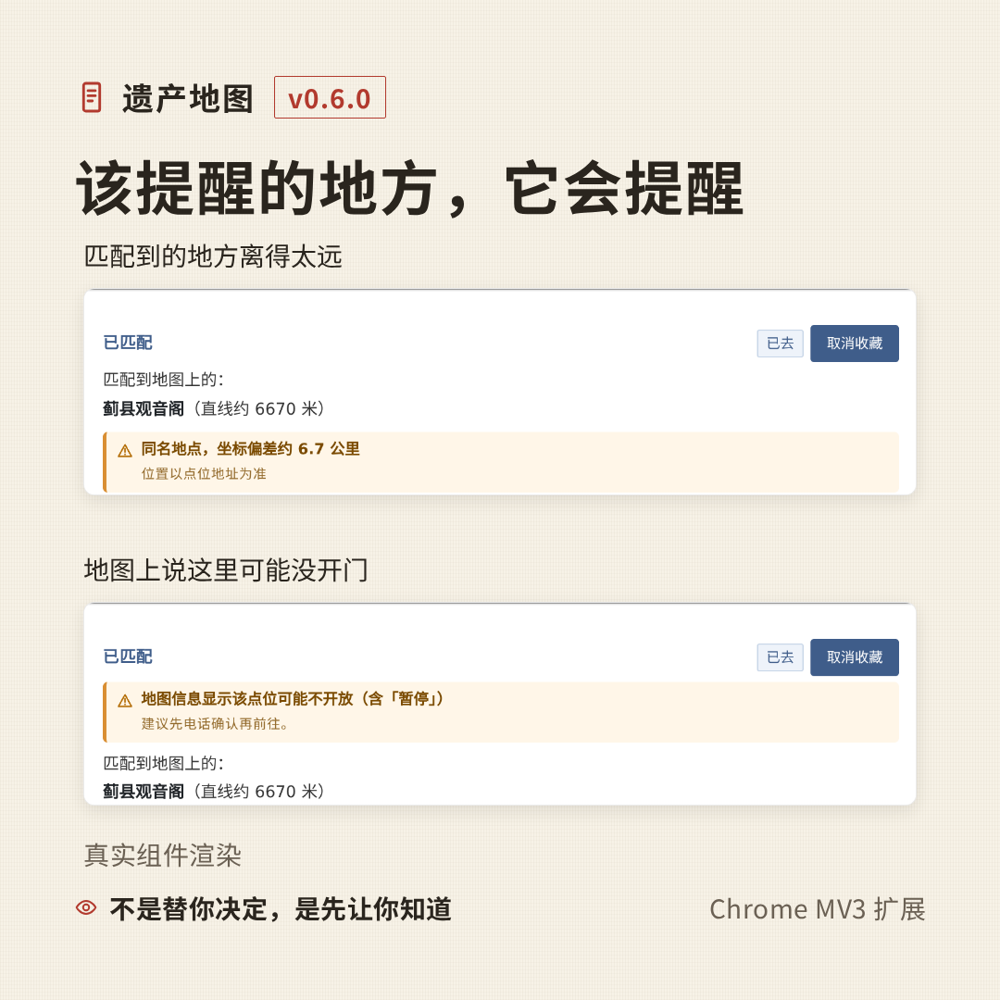
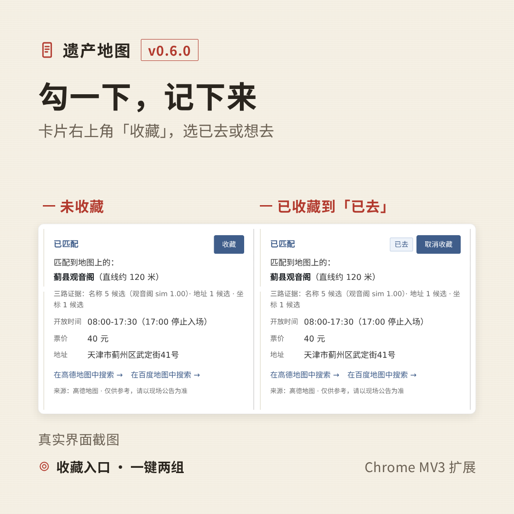
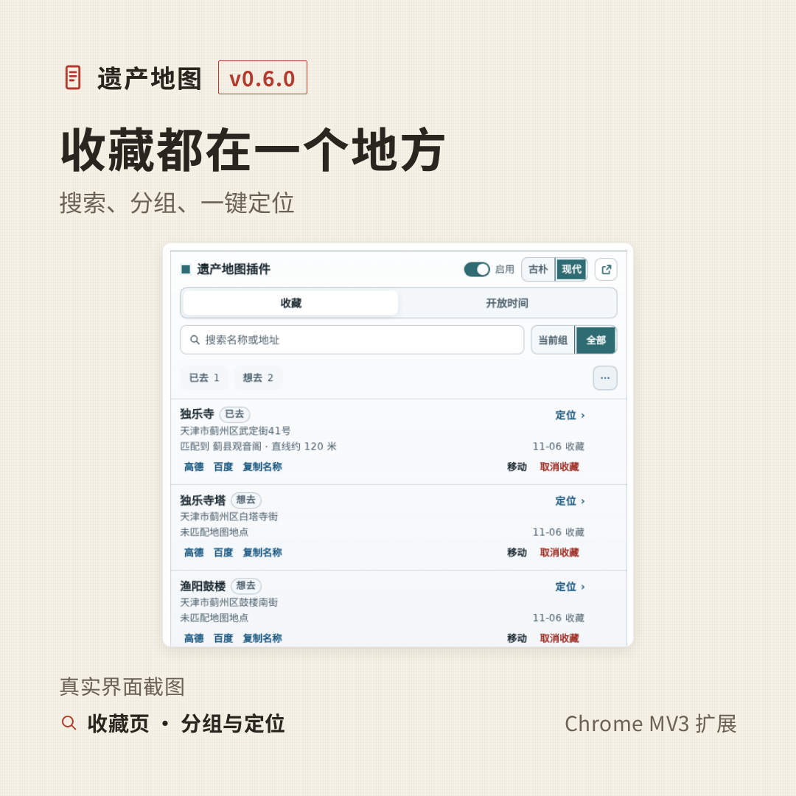
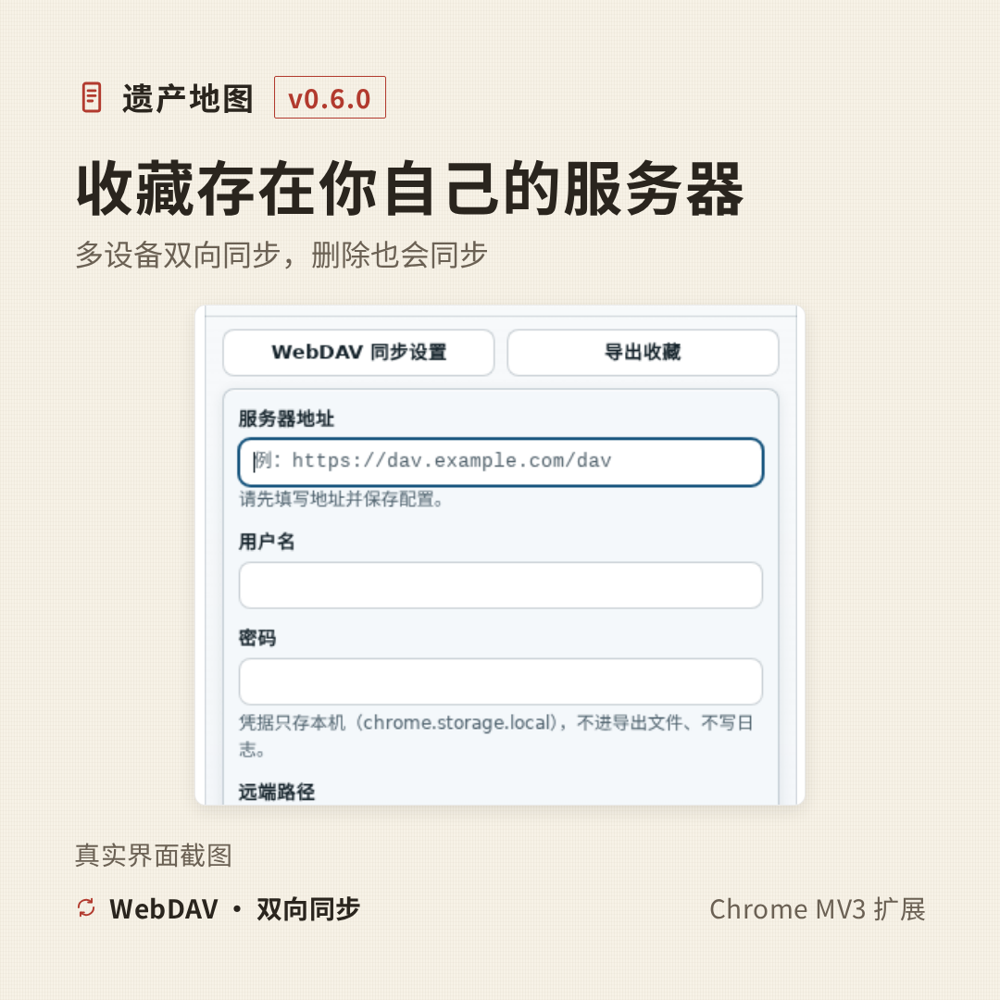
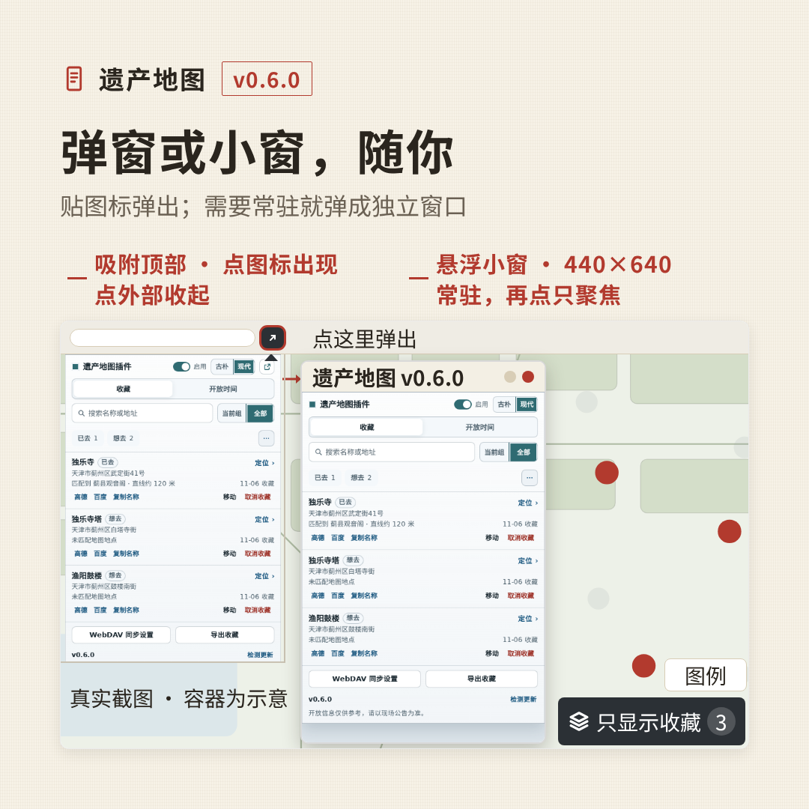
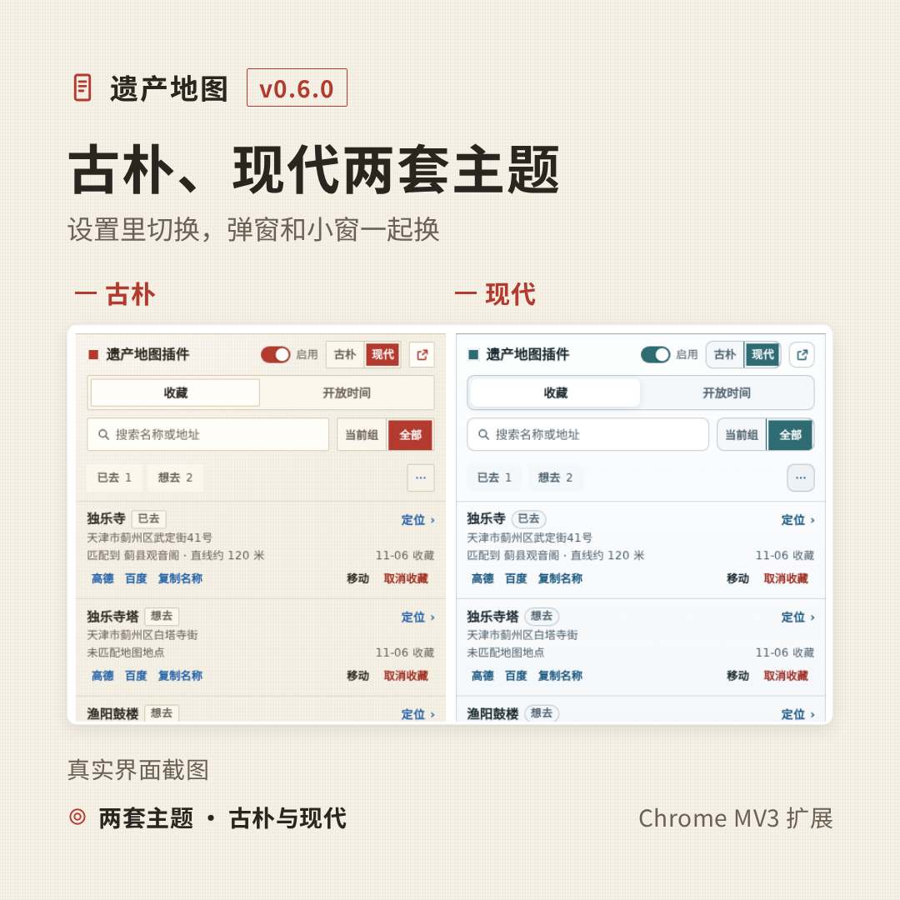
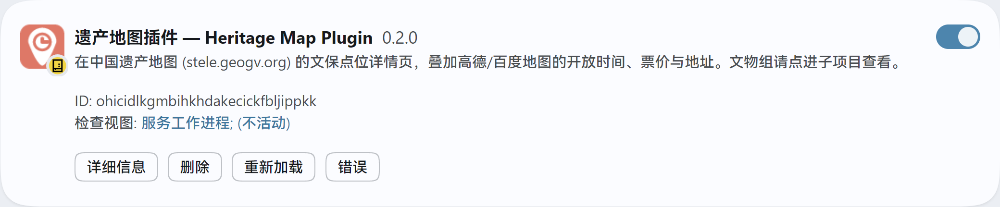

# 遗产地图插件 · STELE 开放信息与收藏夹

> 在 [中国遗产地图 STELE](http://stele.geogv.org/zhcn/) 的文保点位详情页，叠加一张来自**高德地图 / 百度地图**的「开放时间 · 票价 · 地址」卡片。
>
> 0.5.x 起带**收藏夹**：收藏文保点位、按「已去 / 想去」分组、搜索、一键定位，并可用自己的 **WebDAV** 在多设备间同步。
>
> 0.6.0 起地图上可**只显示收藏点位**并按分组单独开关；卡片遇到「匹配到的地方太远」「地图说这里可能没开门」这类情况会主动提醒。
>
> 用你自己申请的地图 API Key；数据只在本机与你自己指定的服务器之间流转，不经过任何第三方中转。

[](LICENSE)



<sub>介质说明：扩展自有界面（弹窗、卡片、WebDAV）为真实截图或真实组件渲染；地图底图与地图控件区为示意图（STELE 站点当日返回 502）；第 7 张的窗口容器为手绘。示例点位：独乐寺（天津市蓟州区武定街41号）。</sub>

---

## ✨ 它能做什么

| | |
| --- | --- |
| **地图只显示收藏**<br>右下角按钮（与站点「图例」同高、右缘对齐）展开分组面板：默认全选、地图只留收藏点；每组独立开关实时生效；再点一次还原。 |  |
| **开放信息卡片**<br>详情页「开放信息」处出现一张与站点风格一致的卡片：开放时间、票价、地址；高德没给就用百度补，反之亦然。 |  |
| **该提醒的地方，它会提醒**<br>匹配到的地点太远（同名坐标偏差 / 超过 3 公里）或地图信息显示「暂停开放 / 维修中」，卡片顶部给出同一套警示块。 |  |
| **收藏入口与分组**<br>卡片右上角「收藏」→ 选「已去 / 想去」；已收藏显示分组标签 +「取消收藏」。 |  |
| **收藏夹**<br>弹窗默认进收藏页：搜索名称或地址、按组筛选、建组移动、取消收藏可撤销、一键定位。 |  |
| **WebDAV 同步**<br>用你自己的服务器双向合并收藏、分组、删除与移动；同步前先传 `.bak` 备份。 |  |
| **弹窗 / 独立小窗**<br>点图标默认贴图标弹窗；点右上角图标弹出 440×640 常驻小窗，再点只聚焦。 |  |
| **两套主题**<br>「古朴」（纸面暖色）与「现代」（玻璃冷色）两套配色，弹窗内一键切换。 |  |

### 具体功能

- 🔍 自动识别当前查看的文保点位（含站点内部路由切换）
- ⏰ **开放时间**：优先整周描述，退化为「今日」；双源互补
- 🎫 **票价**：只在值确实像门票价时才显示（楼盘均价的坑已排除）
- 📍 **地址**：地图侧的地址，与文保地址分开显示
- 🎯 **三路交叉印证**：名称 / 地址 / 坐标；只有单一证据时明确标注
- 🚫 行政点、社区服务站、借用文保名的商户不参与匹配；文物组不硬凑表格
- 💾 同一 POI 结果本地缓存 7 天，节省 API 配额
- 🔗 匹配不到时给「在高德 / 百度地图中搜索 →」跳转
- 🗂️ 顶部 Tab「收藏 / 开放时间」；「开放时间」即原设置页（Key、联网检查、缓存、导出决策）
- ⭐ 卡片右上角「收藏」→ 选「已去 / 想去」；已收藏显示分组标签 +「取消收藏」，弹窗与页面实时同步
- 📚 系统组「已去」「想去」不可改名/删除；旧「未分组」数据升级并入「想去」
- ☁️ WebDAV 配置在收藏页就地展开，保存时按域名单独申请权限，凭据只存本机
- 🗺️ 站点页右下角「只显示收藏」：展开分组面板按收藏分组过滤地图点位，每组可单独开关；再点一次还原（刷新回到不过滤）
- 📍 控件与站点「图例」同高、留 8px、右缘对齐；面板显示「已选 X/Y 组 · 共 N 个点位」
- ⚠️ 两类主动提醒（距离太远 / 可能未开放）统一为同一警示块：浅黄底 + 左橙条 + 三角图标 + 标题/副行
- 🪟 0.6.0 弹窗重排：单行头部、分段页签、400 宽首屏可见 3 条收藏、两工具按钮等宽、页脚单行
- 🌗 弹窗两套主题：古朴 / 现代

## 📦 安装

### 方式一：下载打包好的扩展（推荐）

1. 到 [Releases](https://github.com/PaulCAI1593/STELE-heritage-map-plugin/releases) 下载最新 `heritage-map-plugin-vX.Y.Z.zip`
2. 解压到一个**不会被删除的固定目录**（Chrome 会一直从这里加载）
3. 打开 `chrome://extensions/`，右上角开启「开发者模式」
4. 点「加载已解压的扩展程序」，选中解压出来的目录
5. 点工具栏插件图标，填入地图 API Key，保存

> 点图标默认打开**贴图标的弹窗**（点外面关闭）；弹窗右上角「弹出到新窗口」按钮可变成约 440×640 的**独立窗口**，窗口还在时再点只聚焦。



### 方式二：从源码加载

```bash
git clone https://github.com/PaulCAI1593/STELE-heritage-map-plugin.git
```

然后在 `chrome://extensions/` →「加载已解压的扩展程序」→ 选择仓库里的 **`src/`** 目录（扩展本体在 `src/`，无需构建）。

> ⚠️ 在 `chrome://extensions/` 点了「重新加载」后，**必须再刷新一次 STELE 页面**，否则当前标签页跑的仍是旧脚本。

## 🔑 申请地图 API Key

至少要配一个；**高德免费额度够用，5 分钟能搞定**，建议先配高德。

| 平台 | 类型要求 | 申请地址 |
| --- | --- | --- |
| 高德地图 | **Web 服务** API Key | <https://lbs.amap.com/dev/key/app> |
| 百度地图 | **服务端** AK（不是浏览器端） | <https://lbsyun.baidu.com/apiconsole/key> |

> 百度一定选「**服务端**」类型，IP 白名单填 `0.0.0.0/0`，勾选「地点检索」。
> 选成「浏览器端」会得到 `status=240 APP 服务被禁用`——最常见的坑。

详细图文步骤与报错对照见 [`INSTALL.md`](INSTALL.md)。

## 🔐 权限与隐私

扩展只做两件事：在当前 STELE 文保页读取点位信息、把地图开放信息画到页面上；收藏与同步都在本机或你指定的服务器完成。

| 权限 | 用途 | 说明 |
| --- | --- | --- |
| `storage` | 保存 Key、界面设置、收藏夹 | 只在本机 `chrome.storage.local`，不上传 |
| `host_permissions`（高德 / 百度 / api.github.com / jsDelivr） | 调高德/百度接口取开放信息；检查更新 | 只发请求，不读取这些站点的页面内容 |
| `optional_host_permissions`（`https://*/*`、`http://*/*`） | 仅用于 **WebDAV 同步** | 只在你点「保存配置」时，对你填写的那个地址单独申请，不会访问其它网站 |

关于 `optional_host_permissions` 为什么写成通配：MV3 的 manifest 无法预声明「用户以后自己填的域名」，只能在运行时按需申请；实际授权范围就是你填写的 WebDAV 地址，扩展不对其它站点使用该权限。不用 WebDAV 时，这一项始终未授权。

- 内容脚本只注入 STELE 遗产地图（`stele.geogv.org`），不注入其它站点。
- 不收集、不上报使用数据；不做远程代码加载。
- 高德/百度 Key 只存本机；导出收藏不含 Key、WebDAV 密码或任何凭据。

## 🛠️ 开发与构建

无需安装依赖（构建脚本只用 Node）：

```bash
npm run build            # 重新生成图标 + 打包到 release/
```

### 目录

| 路径 | 说明 |
| --- | --- |
| `src/` | **扩展本体**，直接加载这个目录 |
| `src/content/` | 内容脚本：解码、名称处理、坐标、缓存、匹配、卡片渲染 |
| `src/popup/` | 弹窗：收藏页、设置、Key 测试、缓存与日志导出 |
| `src/shared/` | 收藏存储与 WebDAV 同步 |
| `src/background/` | service worker：独立小窗的窗口管理 |
| `tools/` | 图标生成、打包脚本 |
| `docs/promo/` | 宣传图（当前版本在 `docs/promo/0.6.0/`；旧版图保留） |
| `docs/screenshots/` | 功能截图（含历史版本，供 Release 正文引用） |
| `DESIGN.md` | **方案设计书**：坐标校正推导、三路匹配决策顺序、各类错配成因与对策 |

### 调试入口

在 STELE 详情页打开 DevTools Console：

```js
HMP.debug.status()      // 当前路由、识别到的点位 id、已缓存点位
HMP.debug.inspect()     // 卡片/详情面板的 DOM 现场诊断
HMP.debug.fire({name:'测试', feature_type:'博物馆', geom:{coordinates:[116.4,39.9]}})

HMP.naming.extractCity(['酒泉市 敦煌市'])            // → "敦煌市"
HMP.card.plausiblePrice('81569.00')                  // → false（楼盘均价不是票价）
HMP.card.borrowedNamePenalty('兆丰花园遗址', {name:'兆丰花园', type:'商务住宅;住宅区'})
```

## 🗺️ 它到底怎么匹配的

三条路径并行跑，再交叉印证（而不是三选一）：

1. **名称检索** —— 文保名 / 挖出的现用名 + 市级行政区
2. **地址检索** —— 行政区 + 门牌号（关键字逐级放宽）
3. **坐标周边** —— 仿射校正后的坐标做 1 km 周边搜索

决策顺序优先采信「互相印证」的结果；**只被坐标单独支持的候选会被拒绝**（那通常是隔壁商户）。
短名（如「靳岗天主教堂」→「天主堂」）与纯通名、类型词冲突、地名兜底都有单独规则；完整推导与实测数据见 [`DESIGN.md`](DESIGN.md)。

### 几个踩过的坑

| 现象 | 原因与对策 |
| --- | --- |
| **站点坐标整体偏移约 340 km** | 不是 WGS84↔GCJ02 那 500 m 级差异，而是仿射畸变；拟合后误差降到 ~150 m |
| **文保名 ≠ 现用名** | 从 address/intro 挖「现为 XXX」当检索词，再配合坐标周边搜索 |
| **子项目只有名称、没有地址** | 站点 `members[]` 不含地址，但 `kid` 就是它自己的 feature id；`relationinfo` 写着父项目组，据此借组地址 |
| **泛词子项目乱匹配**（白宫 → 外地同名地点） | 改用「父组名 + 子项名」检索且不搜裸名；名称命中卡 3 km 上限 |
| **小区「借用」文保名** | 候选名是文保名前缀 + 类型是住宅 → 降权；地址只返回该小区时让位给坐标路径 |
| **大型场地落到某个门** | 门址/设施类在所有路径一律排除 |
| **票价显示 81569.00** | 高德 `cost` 对楼盘是房价单价（元/㎡）；只在「像门票价」时显示 |
| **改了匹配逻辑但界面没变** | 7 天缓存。缓存键带 `DATA_VERSION`；重载 → 清缓存 → F5 |

## 🙏 致谢

**这个插件能存在，全靠 [中国遗产地图 STELE](http://stele.geogv.org/zhcn/) 的作者 [Kejing Peng（@pkkj）](https://github.com/pkkj)。**

STELE 是一个由个人长期维护、完全免费且无广告的中国不可移动文物地图：全国重点文物保护单位、省级/市县级文保、世界遗产等数据整理成可检索、可点击的地图。本插件做的事很轻——只是去问一句「这个点位在高德/百度上对应的开放时间是什么」；真正有价值的点位数据、坐标、分类、简介、图片全部来自 STELE。

- **请优先支持 STELE 本身**：多用它、给它反馈、推荐给做文化遗产的人。
- 本插件是**非官方第三方工具**，与 STELE 官方及高德/百度均无隶属关系；若作者认为有不妥，我会立即调整或下架。

> 站点：<http://stele.geogv.org/zhcn/> ｜ 作者 GitHub：<https://github.com/pkkj>

## ⚖️ 免责与合规

- 插件在你的浏览器里读取 STELE 页面**公开展示的数据**，并按你配置的 Key 请求高德/百度；不搭建中转服务器，不收集、不上传用户数据。
- 开放时间等信息来自第三方地图，**可能滞后或出错，出行前请以现场公告为准**。
- 仓库中**不包含** STELE 站点的任何源码或样式文件；本地测试所需的最小数据样本也不入库。

## 🤝 参与

Issue / PR 都欢迎。报告匹配错误时，**带上卡片上「匹配到地图上的：X（直线约 N 米）」那一行**与点位名称——这一行基本能定位是名称、地址还是坐标路径出的问题。

## 📝 更新日志

见 [CHANGELOG.md](CHANGELOG.md)。

## 📄 许可证

[MIT](LICENSE) © 2026 PaulCAI1593
